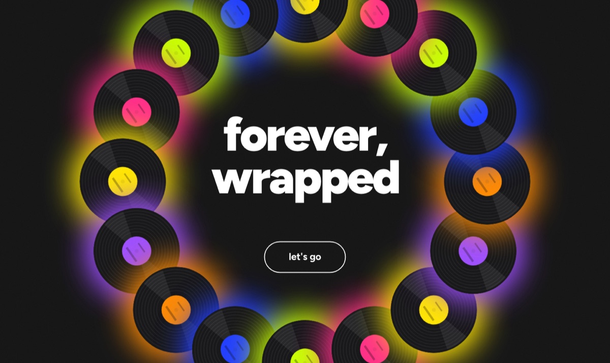
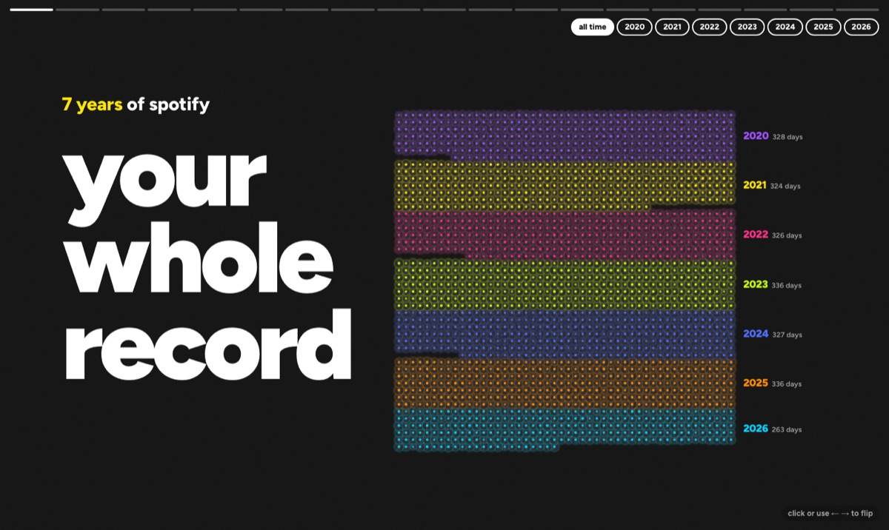
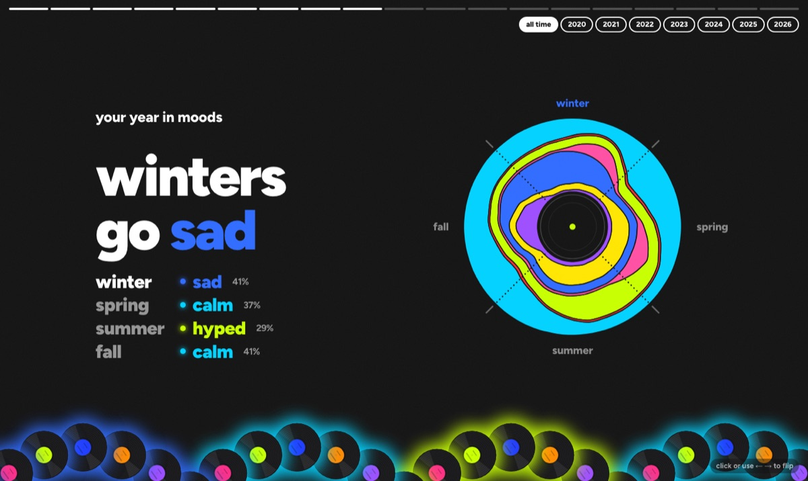
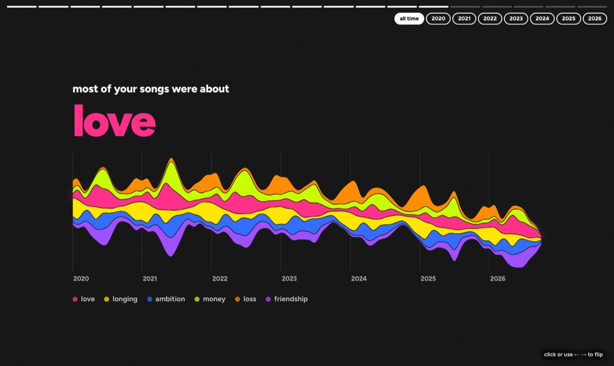

# Forever, Wrapped

Spotify Wrapped, but for every song you've ever played instead of just this year.

You give it your full Spotify history and it makes a website about you: 19 pages you click through
like a story, plus a page for each era of your listening. Every page works for all time or any
single year. Claude listens in on the lyrics and tags each song with a mood and what it's about, so
it can tell you things like which season you go sad in.



| | |
|---|---|
|  |  |
|  | |

*(These screenshots use the made-up practice data, so the records have plain labels. Yours show
your own album covers.)*

It all runs on your own computer, and the site is just files you open in your browser. Nothing is
uploaded anywhere except song titles and lyrics, which go to Claude for tagging and to
[LRCLIB](https://lrclib.net) to look up lyrics.

---

## Before you start

You'll need three things. Ask Spotify first, since it's the slow one.

### 1. Your Spotify history (ask today, it takes a while)

1. Go to https://www.spotify.com/account/privacy/ and log in.
2. Scroll to **Download your data**. Tick **Extended streaming history** and untick the others.
3. Click **Request data**, then confirm in the email Spotify sends you.

Spotify says it takes up to 30 days; it's often a few days. You'll get an email with a zip file.

> The regular "Account data" download only covers the last year and won't work. It has to be
> **Extended streaming history**.

### 2. Python 3.10 or newer

Open Terminal (Mac) or PowerShell (Windows) and type `python3 --version` (on Windows,
`py --version`). If it says 3.10 or higher you're set. If not, install it from
https://www.python.org/downloads/.

### 3. A Claude API key, with a few dollars on it

1. Make an account at https://console.anthropic.com.
2. Add credit under **Billing**. $10 is plenty for most people.
3. Under **API Keys**, create a key and copy it (it starts with `sk-ant-`).

**What it costs:** about $1 for every 750 songs you've played. Most histories have 3,000 to
10,000 different songs, so expect $4 to $14. Before spending anything, the tag step tells you the
estimate for your history and asks if you want to go ahead.

---

## Install (once)

Download this project (the green **Code** button > **Download ZIP**, then unzip it, or
`git clone` it). Open Terminal in that folder and run:

**Mac / Linux**
```bash
python3 -m venv .venv
source .venv/bin/activate
pip install -r requirements.txt
cp .env.example .env
```

**Windows (PowerShell)**
```powershell
py -m venv .venv
.venv\Scripts\activate
pip install -r requirements.txt
copy .env.example .env
```

Now open the new `.env` file in any text editor and replace `sk-ant-...` with your key. The key
stays in that file on your computer. Never paste it anywhere else.

> Every time you open a new Terminal window to work on this, run the `activate` line again first
> (`source .venv/bin/activate` or `.venv\Scripts\activate`).

---

## Try it with fake data first (2 minutes, free)

This makes up a few years of listening and builds the whole site from it, without using your key:

```bash
python run.py sample
python run.py all --mode mock
```

Then open `web/index.html` in your browser by double-clicking it, or with `open web/index.html`
(Mac) or `start web\index.html` (Windows).

When you're done looking, clear the fake data out:

```bash
python run.py clean
```

---

## Make yours

1. Put the zip Spotify emailed you into this project's `data/raw/` folder, as it is. (Already
   unzipped it? Put the folder in `data/raw/` instead; that works too.)
2. Run:

```bash
python run.py all --mode batch
```

That one command does every step in order:

| Step | What it does | How long |
|---|---|---|
| load | reads your history | seconds |
| lyrics | looks up lyrics for each song (free) | 1 to 3 hours for a big history |
| tag | Claude gives each song a mood and themes; shows the cost and asks first | 10 minutes to an hour |
| eras | finds the stretches of your life with their own sound, and Claude names them | a minute |
| build | works out every chart and writes the site | a minute |

3. Open `web/index.html`. That's your site.

**It's safe to stop and restart.** Press Ctrl+C at any point and run the same command later. Every
step saves as it goes and only does what's left, so you never pay twice for the same song.

**Want to see a few tags before paying for all of them?** Run the steps one at a time instead:

```bash
python run.py load
python run.py lyrics
python run.py tag --mode live --limit 50   # just your top 50 songs, a few cents
```

Look at `data/cache/tags.jsonl`, and if you like what you see, carry on with
`python run.py tag --mode batch`, `python run.py eras` and `python run.py build`.

---

## Add your photos (optional)

Each era page has room for photos from that time. The photos step picks up to 6 per era using the
date saved inside each photo, and works out where you were from their locations.

**On a Mac**, it can read your Photos app directly (it asks for permission the first time):

```bash
python run.py photos
```

**On any computer**, export some photos into a folder and point it there. Phone photos work best
because they have dates and locations saved in them. iPhone `.HEIC` files are fine.

```bash
python run.py photos --folder path/to/your/photos
```

Or skip all that: drop pictures straight into the era folders in `web/photos/` and run
`python run.py build`.

**Where you lived:** the photos step writes `era_notes.csv`, with one row per era. Open it in
Excel, Numbers or Google Sheets, fill in the `lived_in` column, and run `python run.py build` again.

---

## Using the site

- Click the right side of the page or press → to go forward, and ← to go back.
- The buttons at the top right switch between **All time** and a single year.
- On the eras page, click any era to open it.
- On the themes page, click a theme to see your songs about it.

**Sharing it:** the `web/` folder *is* the site. Zip it and send it, or put it on any free static
host (Netlify Drop, GitHub Pages, Vercel). Keep in mind it contains your full listening history and
any photos you added, so only put it online if you're happy for people to see that.

---

## Fixing things

**Claude got a song's mood wrong.** Copy `mood_overrides.example.csv` to `mood_overrides.csv`, add
a line like `Song Title,Artist Name,sad`, and run `python run.py build`. The moods are hyped, happy,
sad, lonely, calm, nostalgic, hopeful, angry, anxious and romantic.

**An era's name doesn't fit.** `python run.py eras --names-only` asks Claude to rename your eras
without finding them again, so your photos and `era_notes.csv` stay matched (about a cent). Then run
`python run.py build`.

**"No Spotify history found".** Check that the zip (or its folder) is inside `data/raw/`, and that
it's the **Extended streaming history** download: it has files named like
`Streaming_History_Audio_2023_4.json`.

**"ANTHROPIC_API_KEY is not set".** Open `.env` and check that your key is on the
`ANTHROPIC_API_KEY=` line, with no spaces or quotes around it.

**"Your credit balance is too low".** Add credit at https://console.anthropic.com, then run the same
command again. It picks up where it stopped.

**`python3` / `py` isn't found, or `pip install` fails.** Install Python from
https://www.python.org/downloads/. On Windows, tick **Add Python to PATH** in the installer.

**Some album covers are missing.** Covers come from Spotify's public pages, so you need to be
online while it builds. Songs that have been removed from Spotify won't have one. Run
`python run.py build` again later to retry.

**I want cities on the map, not just countries.** Download "IP to City Lite" (MMDB format) from
https://db-ip.com/db/download/ip-to-city-lite, unzip it, put the `.mmdb` file in `data/raw/`, and
run `python run.py load` and `python run.py build` again. The lookup happens on your computer.

**I want to start over.** `python run.py clean` deletes everything it has made (it asks first).
Your saved tags go too, so tagging again costs money again.

---

## Making it your own

| Change | Where |
|---|---|
| the moods and themes Claude chooses from | `MOODS` and `THEMES` in `wrapped/config.py` |
| what counts as a skip, a session, and so on | the numbers in `wrapped/config.py` |
| your time zone, and time zones for places you've lived | `HOME_TZ` in `.env`, `COUNTRY_TZ` in `wrapped/config.py` |
| which Claude models are used | `TAG_MODEL` and `WRITER_MODEL` in `.env` |
| a page's look or wording | `web/slides/`, one file per page; see `web/slides/README.md` |

[`HOW_IT_WORKS.md`](HOW_IT_WORKS.md) walks through how every step and chart is worked out.

## Privacy

Your history, saved tags, photos, covers, `.env` and `era_notes.csv` are all in `.gitignore`. If you
fork this repo and push your changes, none of your listening goes with them.

## License

MIT. See [LICENSE](LICENSE).
